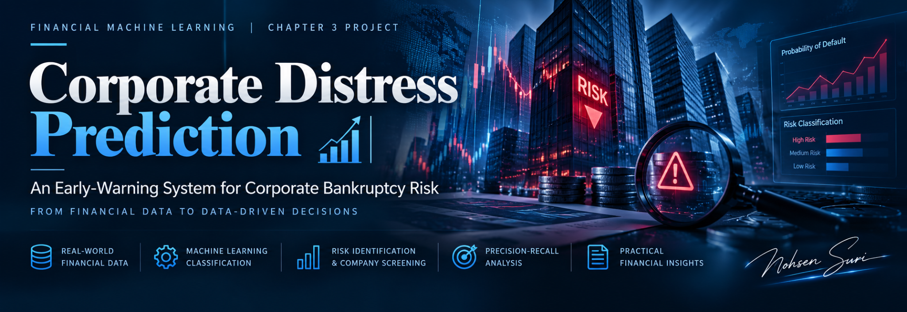

<div align="center">



# Corporate Distress Prediction & Credit Risk Classification

**Financial Machine Learning · Corporate Credit Risk · Python**

*An early-warning approach to bankruptcy detection, credit-rating classification, and risk-based company screening.*


</div>

---

## Project Overview

This project explores how machine learning can support corporate credit risk assessment through two related tasks:

1. **Bankruptcy prediction:** Identify companies at risk of bankruptcy using financial indicators.
2. **Credit rating classification:** Group corporate credit ratings into high-grade, medium-grade, and speculative-grade categories.

Beyond predictive performance, the project evaluates the practical consequences of false alarms, missed bankruptcies, and errors at the investment-grade boundary. A final case study ranks companies by predicted bankruptcy risk to prioritize a limited number of credit investigations.

## Datasets

- **Taiwanese Company Bankruptcy Prediction:** Financial indicators and a binary bankruptcy outcome.
- **Corporate Credit Rating:** Company-level information and credit rating labels.

The notebook expects **both datasets as CSV files** inside a `data/` folder and identifies them by the `Bankrupt?` and `Rating` column names, respectively. Dataset files are not included in this README. Confirm their redistribution terms before publishing them in a public repository.

## Methodology

### Bankruptcy prediction

- Explore class imbalance and establish a majority-class **Dummy Classifier** baseline.
- Train **Logistic Regression**, **Balanced Logistic Regression**, and **Random Forest** models.
- Evaluate models using **stratified 5-fold cross-validation**.
- Compare accuracy, precision, recall, F1, ROC-AUC, and **Average Precision**.
- Analyze decision thresholds to target higher bankruptcy detection rates.
- Assess the selected model on a held-out test set.

### Credit rating classification

- Map ratings to three classes: **High grade** (AAA–A), **Medium grade** (BBB), and **Speculative** (BB and below).
- Train a **Support Vector Classifier (SVC)** with preprocessing.
- Use a **company-aware train-test split** and **Stratified Group 5-Fold Cross-Validation** to reduce company overlap across evaluation groups.
- Examine errors across the investment-grade/speculative-grade boundary.

## Key Results

The following figures are **reported in the project notebook**.

### Bankruptcy prediction — Random Forest (held-out test set)

| Metric | Result |
|---|---:|
| Accuracy | 93.77% |
| ROC-AUC | 0.9558 |
| Average Precision | 0.5290 |
| Precision | 30.84% |
| Recall | 75.00% |
| F1 Score | 0.4371 |

At the selected decision threshold, the model identified **33 of 44 bankrupt companies**, with **74 false positives** and **11 missed bankruptcies**. These results highlight the trade-off between detecting financial distress and increasing investigation workload.

### Credit rating classification — SVC

| Metric | Result |
|---|---:|
| Accuracy | 52.27% |
| Macro F1 | 0.4973 |
| Weighted F1 | 0.5225 |

The model made **116 classification errors across the investment-grade boundary**, including **58 speculative-grade cases incorrectly classified as investment grade**. These errors are particularly important for credit decisions.

## Business Application: Prioritizing 50 Companies

Suppose a credit team can investigate only **50 companies**. Ranking the held-out test observations by predicted bankruptcy probability gave the following results:

| Metric | Result |
|---|---:|
| Bankrupt companies found in top 50 | 25 |
| Precision@50 | 50.00% |
| Recall@50 | 56.82% |
| Lift@50 over random selection | 15.5× |

The ranking identified **25 of the 44 bankrupt companies** in the held-out test sample. This illustrates how a risk-scoring model can help allocate limited analyst time more effectively; it does not establish prospective real-world performance.

## Repository Structure

```text
Corporate-Distress-Prediction/
├── Corporate_Distress_Prediction.ipynb
├── README.md
├── assets/
│   └── corporate-distress-banner.png
├── requirements.txt
├── .gitignore
└── data/                    # Place required CSV files here locally
```

The `requirements.txt` and `.gitignore` files are prepared separately in the next setup step. The notebook may also create a `results/` directory when executed.

## Running the Notebook

1. Clone or download the repository.
2. Create a Python environment and install the project dependencies using `pip install -r requirements.txt` once that file has been added.
3. Place the two source CSV datasets inside the `data/` folder.
4. Open `Corporate_Distress_Prediction.ipynb` in Jupyter or VS Code.
5. Run the notebook cells in order from the project root directory.

> **Important:** The notebook loads its files relative to the current working directory. Missing CSV files will raise a `FileNotFoundError`.

## Limitations

- Bankruptcy events are rare, so high accuracy alone can be misleading.
- False positives create additional work for credit analysts; false negatives can conceal risk.
- Credit rating results are moderate and include consequential boundary misclassifications.
- Historical held-out performance does not guarantee future results.
- A fully time-based validation and additional out-of-sample testing would be valuable before deployment.

## Conclusion

Machine learning can assist financial analysts by identifying potential corporate distress and prioritizing credit reviews. The results should be treated as **decision-support evidence**, not as automated lending or investment recommendations.

---

<div align="center">

### Project Author

**Mohsen Suri**

[LinkedIn](https://www.linkedin.com/in/mohsen-suri/)

*From Financial Foundations to Predictive Strategies*

</div>
